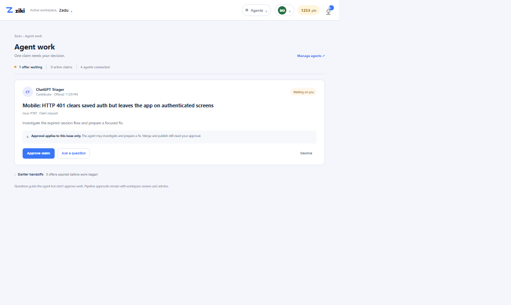

# V4 intent brief — workspace operator

## WHO

A ZEDU workspace operator who checks in daily and needs to know whether agents are working or waiting for a human.

## INTENT

“Show me the one thing an agent needs from me, and what my approval actually permits.”

## EMOTION

Time-constrained, responsible, and wary of an agent making a commitment in their name.

## DECISION

Should I approve ChatGPT Triager’s claim request for issue #787?

## OLD UI

Activity & Approvals spreads escalation responses, pipeline gates, work history, and recent activity across sections. Filters help find records but make the operator reconstruct current work and the next human decision. Repeated claim states can be mistaken for a live request.

## CHANGE

The screen opens on one pending claim, with only the agent, issue, proposed task, and approval scope needed to decide. Earlier expired offers are collapsed by default. The key distinction—questions guide work but do not approve it—is kept visible without a second policy panel.

## AI / HUMAN

The agent may investigate and prepare a fix after a claim is approved. The human approves or declines this issue-specific claim. Merge, publish, spend, scope changes, and workspace pipeline gates remain behind human approval.

## Boundary rule

“Approve claim” permits ChatGPT Triager to investigate and prepare a fix for issue #787 only. It does not permit merge or publication. Asking a question guides the agent but leaves the claim unapproved. Decline means no work starts.

## Before / after

## Rationale

The earlier concept still looked like an operations dashboard: multiple metric cards, parallel panels, and repeated explanations competed with the decision. This version uses one focal handoff and makes the permission consequence legible at the point of approval. Collapsing prior expired offers preserves context without making history the main task. It keeps the existing Ziki visual language and changes hierarchy rather than adding a new theme.
